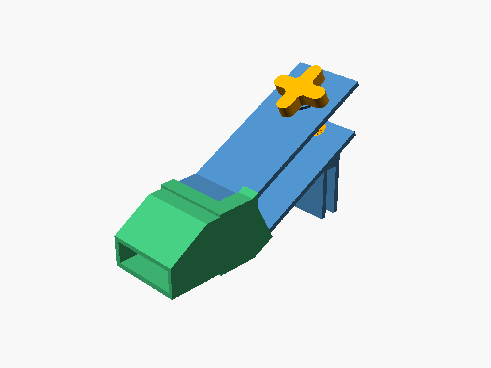
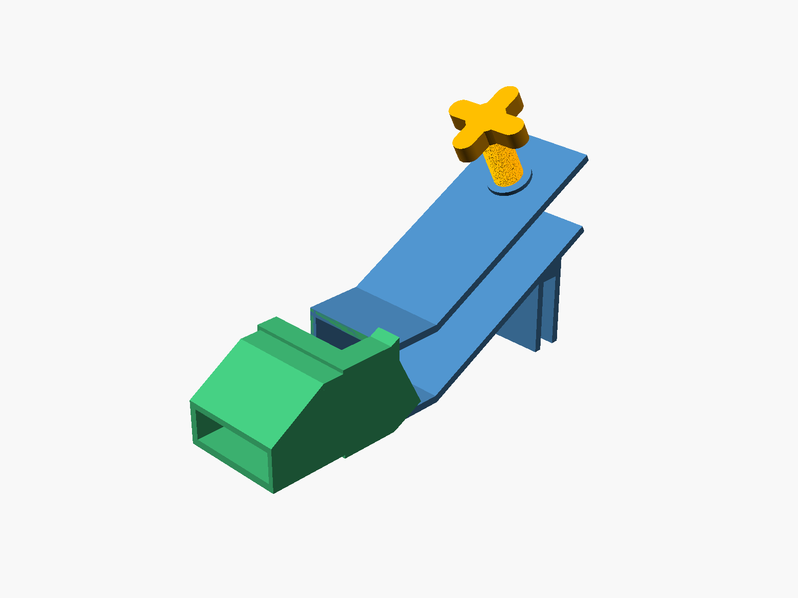
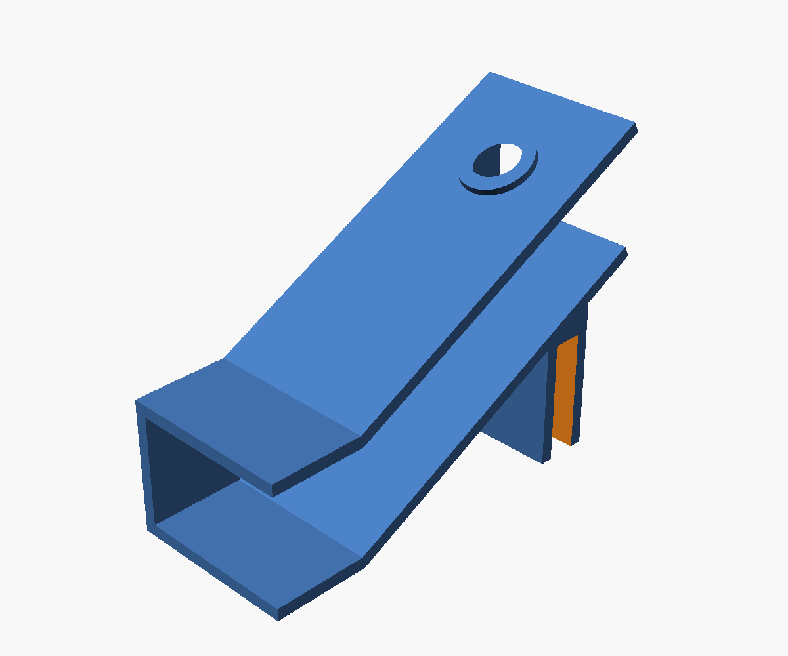
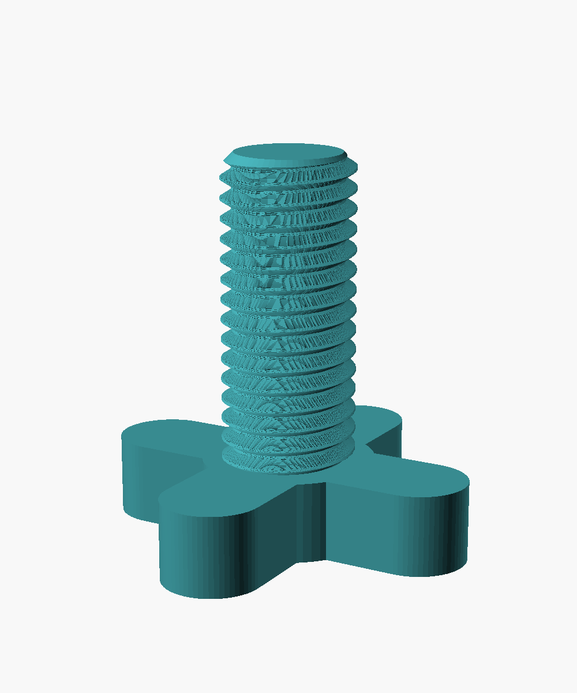
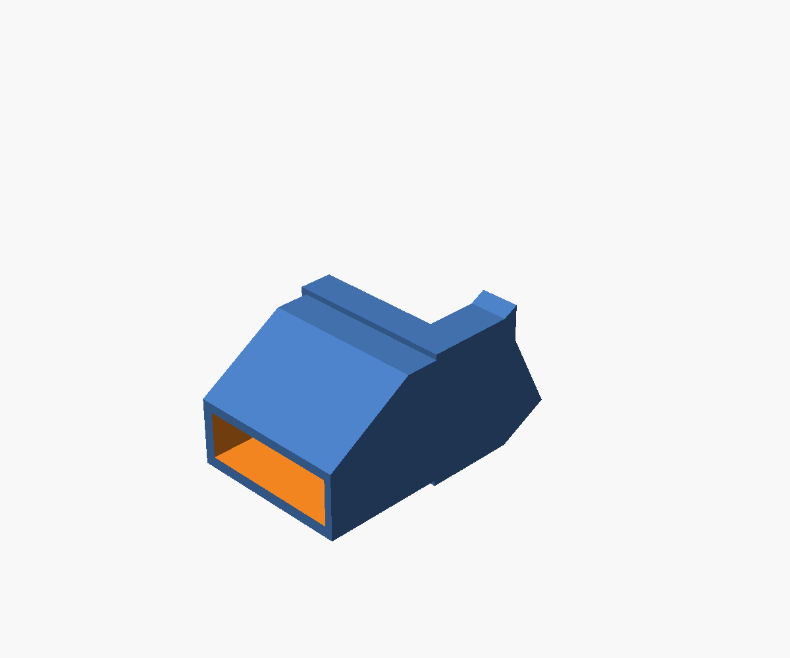
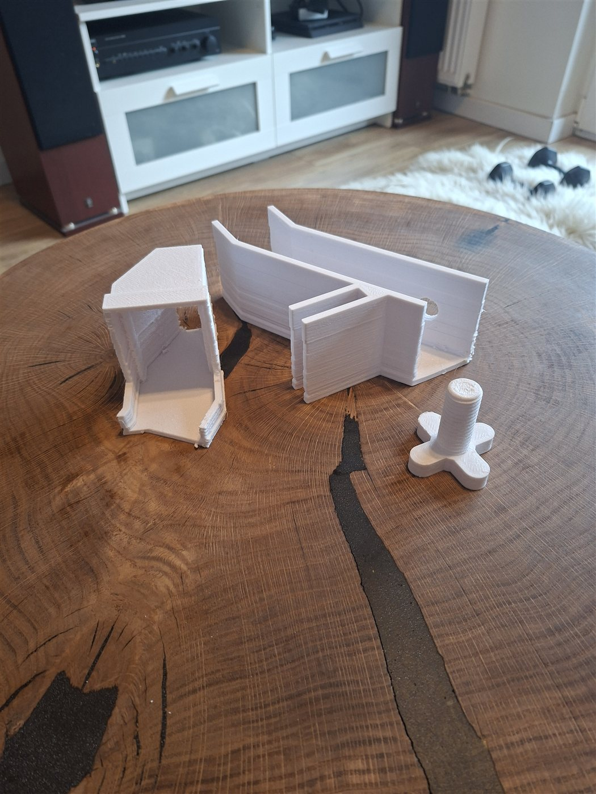
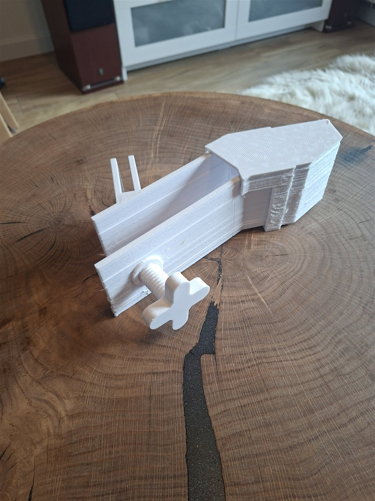

# Aquarium Refill Hose Holder

A 3D-printable hose holder that clips onto the edge of the aquarium glass and keeps the hose in place while you refill the tank after a water change. The hose sits in a sloped tunnel and a thumb screw clamps it there. An outlet extension at the end of the tunnel points the water stream downward, so the tank fills calmly and the water doesn't splash over the rim.

The model is written in OpenSCAD and is fully parametric. Each part is a single self-contained `.scad` file, and `assembly.scad` checks that the dimensions shared between the parts still match.

## 📷 Gallery

<p align="center">
  
  
</p>

<p align="center">
  
  
  
</p>

* **Assembly:** the glass mount (blue), the clamp screw (orange) and the outlet extension (green) in their mounted positions.
* **Exploded view:** the screw lifted out of its threaded hole and the extension pulled off the tunnel end.
* **Parts:** the glass mount, the clamp screw and the outlet extension (shown on its own, with the 45 → 20 mm channel visible at the outlet).

### Printed prototype

<p align="center">
  
  
</p>

* **Left:** the three printed parts (outlet extension, glass mount, clamp screw).
* **Right:** the holder put together, with the clamp screw in the threaded hole and the outlet extension on the tunnel end.
* **Videos:** [clip 1 (7 s)](images/20261112_182633.mp4) · [clip 2 (6 s)](images/20261112_182649.mp4)

The prototype was printed from v1.0, before the lead-in chamfer was added to the screw hole.

## 🧩 Parts

| # | Part | File | Description |
|---|------|------|-------------|
| 1 | **Glass mount** | `1_glass_mount.scad` | A clip for the aquarium glass with a sloped tunnel above it (lower plate, upper plate, side wall). The upper plate has a threaded hole with a reinforcing boss. |
| 2 | **Clamp screw** | `2_clamp_screw.scad` | A Ø20 mm thumb screw with a 4-spoke cross knob. Screw it in to press the hose against the lower plate. |
| 3 | **Outlet extension** | `3_outlet_extension.scad` | A sleeve that slides onto the tunnel end. It closes the open side of the tunnel, extends the water channel with no step in the floor, and lowers the channel ceiling toward the outlet so the stream is pushed down. |

## 📏 Default Dimensions

With the default parameters, the parts have the following specifications:

**Glass mount**
* **Glass slot:** 12 mm (glass thickness plus fit clearance), 50 mm deep, 70 mm wide
* **Tunnel:** 27° slope, 45 mm vertical clearance between the plates (39.5 mm measured square to the plates), 65 mm clear width
* **Tunnel length:** 75 mm base plate + 80 mm slope extension, then a 40 mm horizontal section
* **Screw hole:** Ø21 mm threaded hole (Ø20 mm + 1 mm clearance), 3 mm pitch, on a Ø30 × 3 mm boss, with a 45° lead-in chamfer
* **Overall size:** approx. 70 × 178 × 128 mm

**Clamp screw**
* **Thread:** Ø20 mm, 3 mm pitch, 46 mm long (8 mm in the plate and boss + 38 mm of clamping travel), 2.5 mm chamfer at the tip
* **Knob:** 4-spoke cross, 58 mm across, Ø26 mm hub, 12 mm thick

**Outlet extension**
* **Length:** 55 mm past the tunnel end (15 mm straight, then a 40 mm section where the ceiling drops)
* **Outlet:** the channel narrows from 65 × 45 mm to 65 × 20 mm
* **Fit:** 15 mm collar around the tunnel end, side shell reaching 25 mm back onto the slope, 3.5 mm walls

## ✨ Features

* **One File per Part:** each part file contains all of its parameters and geometry, so you can open, customise and export it on its own (it also works with the OpenSCAD Customizer).
* **Sync Check:** values marked `[SHARED]` appear in more than one part file. `assembly.scad` compares them and stops with an error if they differ, or if the screw is too long for the tunnel.
* **Tool-Free Clamping:** the large cross knob lets you tighten the hose by hand. The threaded hole and the screw use the same thread profile, and both threads are phase-locked to the seat plane, so they mesh in the assembly preview too.
* **Exact-Fit Sleeve:** the extension's socket is cut from the actual tunnel shape (`tunnel_envelope()`), so the slope angle and the bend match the glass mount exactly.
* **No Step in the Floor:** the extension's channel lines up with the inside of the tunnel, so water flows over the joint without a step.
* **Downward Outlet:** the lowered ceiling at the outlet turns the stream down into the tank instead of letting it shoot forward.
* **Fast-Rendering Thread:** a single twisted `linear_extrude`, which renders much faster than a polyhedron-based thread.

## 🚀 Usage

1. Install [OpenSCAD](https://openscad.org/) (tested with 2021.01).
2. Open `1_glass_mount.scad` and set `glass_thickness` to your aquarium glass thickness plus about 0.2–0.5 mm of clearance.
3. If you changed a value marked `[SHARED]`, copy it to the other part files (see the table below).
4. Open `assembly.scad` and press **F5**. It previews the whole set and checks that the part files still match. Set `explode = 40` for an exploded view.
5. Open each part file (`1_…`, `2_…`, `3_…`), render it (**F6**) and export an STL (**F7**).
   Ready-made STLs for the default dimensions are in the [`stl/`](stl/) folder.

### Shared parameters

| Parameter(s) | Defined in | Copy to |
|--------------|------------|---------|
| Glass clip and tunnel (`glass_thickness`, `clip_*`, `wall_thickness`, `tilt_angle`, `plate_*`, `slope_extension`, `straight_length`, `tunnel_height`, `*_plate_thickness`) | `1_glass_mount.scad` | `3_outlet_extension.scad` |
| `screw_diameter`, `thread_pitch` | `1_glass_mount.scad` | `2_clamp_screw.scad` |
| `grip_length` (= `upper_plate_thickness + boss_height`), `clamp_reach` (< clear gap) | `2_clamp_screw.scad` | — (the glass mount echoes both target values in the console) |

### Key parameters

| Parameter | File | Default | Description |
|-----------|------|---------|-------------|
| `glass_thickness` | 1, 3 | `12` | Width of the glass slot (glass + clearance) |
| `clip_height` | 1, 3 | `50` | How far the clip reaches down over the glass |
| `tilt_angle` | 1, 3 | `27` | Slope of the tunnel |
| `slope_extension` | 1, 3 | `80` | Extra length of the sloped section |
| `straight_length` | 1, 3 | `40` | Horizontal section at the tunnel end (`0` = none) |
| `tunnel_height` | 1, 3 | `50` | Vertical spacing between the plates |
| `screw_diameter` / `thread_pitch` | 1, 2 | `20` / `3` | Clamp screw thread |
| `hole_clearance` | 1 | `1.0` | Extra diameter of the threaded hole |
| `threaded_hole` | 1 | `true` | `false` makes a plain hole instead of a threaded one |
| `clamp_reach` | 2 | `38` | Thread length below the upper plate |
| `fit_clearance` | 3 | `-1` | How tightly the sleeve grips the tunnel |

## 📁 Project Structure

```
aquarium-refill-hose-holder/
├── 1_glass_mount.scad        # Part 1 (self-contained)
├── 2_clamp_screw.scad        # Part 2 (self-contained)
├── 3_outlet_extension.scad   # Part 3 (self-contained)
├── assembly.scad             # Preview of the complete set + sync check
├── stl/                      # Ready-to-print STLs (default dimensions)
└── images/                   # Renders, prototype photos and videos
```

## 🖨️ Recommended Print Settings

* **Material:** PETG. It holds up well to water and humidity and has good layer adhesion. Use plain filament without additives for parts that touch aquarium water.
* **Glass mount:** print it on its side, lying on the closed side wall (the clip and the side wall form one flat face). Use tree supports for the boss and the screw hole.
* **Clamp screw:** print it standing on the knob, without supports. Use 0.2 mm layers or finer so the thread prints cleanly, and 3–4 walls so the shank is strong.
* **Outlet extension:** turn on supports if your slicer finds overhangs on the collar.
* **Walls:** 3–4 perimeters for strength and water resistance.

The prototype was printed on a Creality Ender-3 sliced in Cura, at 240 °C nozzle / 70 °C bed with 0.32 mm layers, gyroid infill and tree supports.

## ⚠️ Fit & Tolerances

* **Glass slot:** measure your glass and add 0.2–0.5 mm. If the slot is too tight it can crack thin glass, and if it is too loose the holder will wobble.
* **Screw hole:** `hole_clearance = 1.0` (Ø21 mm hole for the Ø20 mm screw) gives 0.5 mm of radial play, which is only about 0.27 mm measured square to the thread flanks. The glass mount is printed on its side, so the hole axis lies horizontal and the thread in the hole comes out rougher than the screw. If the screw binds, increase `hole_clearance` to 1.4–1.6 (only the glass mount needs reprinting). If it's loose, decrease it.
* **Outlet extension:** `fit_clearance` in `3_outlet_extension.scad` sets how tightly the sleeve grips the tunnel. The default of `-1` was arrived at through test prints. Test it on your own printer: increase the value if the sleeve doesn't slide on, decrease it if the sleeve is loose.

## 📝 Changelog

**v1.1**
* One self-contained `.scad` file per part; `config.scad` and `lib/` removed
* `assembly.scad` checks that the shared values match and that the screw is not too long for the tunnel
* Hole and screw threads phase-locked to the seat plane, so the screw meshes with the hole in the assembly preview (before, the threads overlapped)
* 45° lead-in chamfer at the top of the threaded hole
* Photos and videos of the printed prototype

**v1.0** – First printed version
* Refactored into a shared `config.scad` and reusable `lib/` modules, with English names and comments
* Glass mount, clamp screw and outlet extension in separate part files
* `assembly.scad` preview with an exploded view

---
*This project is source-available under the [Creative Commons Attribution-NonCommercial-ShareAlike 4.0 International](LICENSE) license (CC BY-NC-SA 4.0). You are free to share and adapt it for non-commercial purposes, as long as you give credit and release your changes under the same license. If you wish to use this project for commercial purposes, please contact me. Developed and designed by Maciej Ślubowski.*
